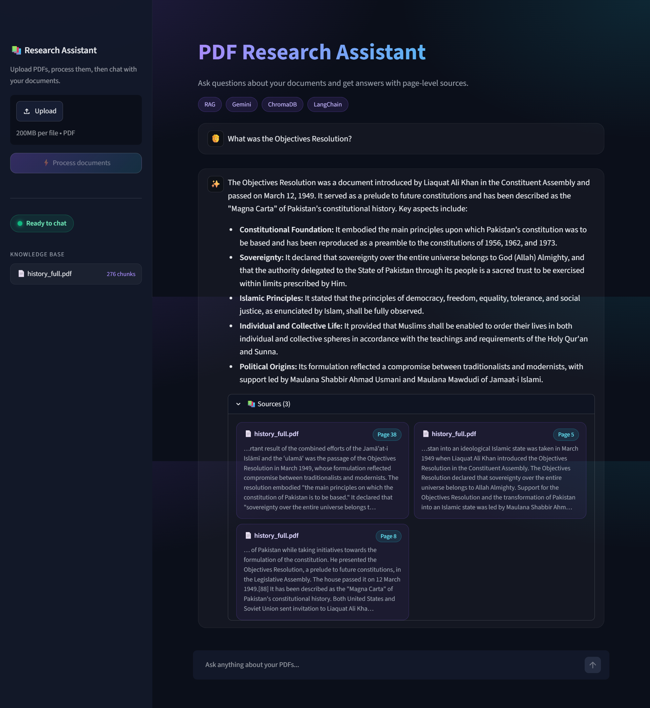
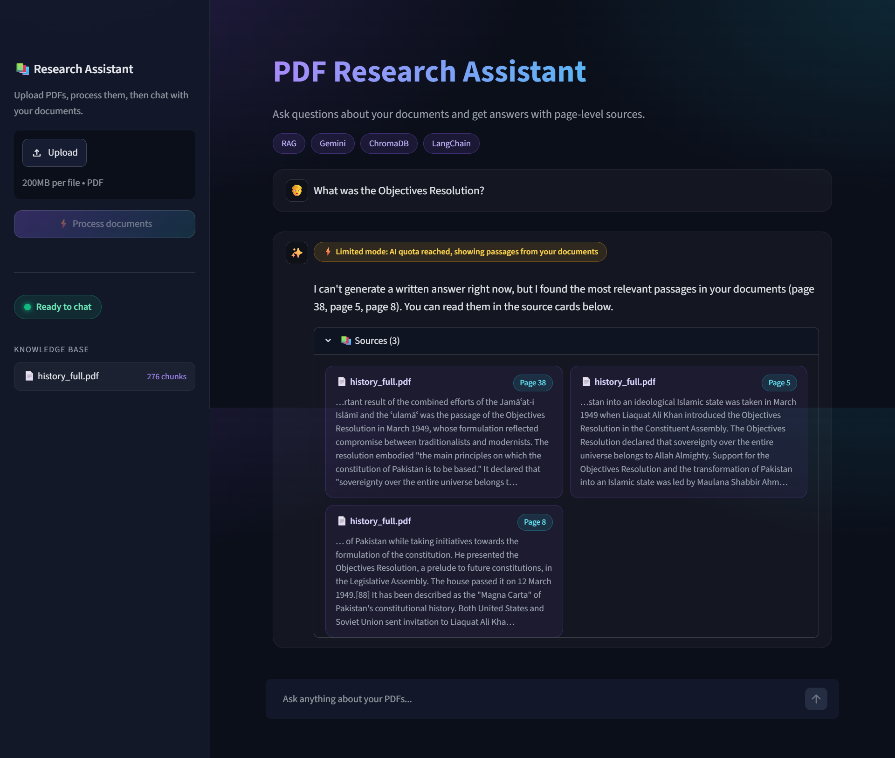
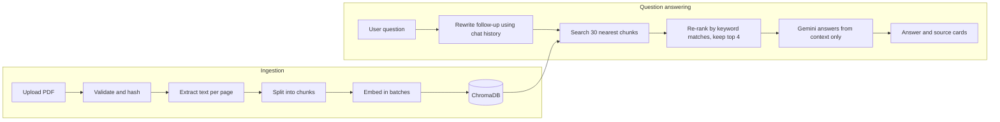

# Personalized PDF Research Assistant

A Retrieval-Augmented Generation (RAG) app that lets you upload your own PDFs and chat with them. Answers come **only from your documents**, and every answer shows the **file, page number and a text snippet** it was based on.




## Table of Contents

- [Features](#features)
- [Screenshots](#screenshots)
- [Tech Stack](#tech-stack)
- [How It Works](#how-it-works)
- [Getting Started: How to Run the Project](#getting-started-how-to-run-the-project)
- [Using the App](#using-the-app)
- [Configuration](#configuration)
- [Project Structure](#project-structure)
- [Testing](#testing)
- [Troubleshooting](#troubleshooting)
- [Design Decisions](#design-decisions)
- [Known Limitations](#known-limitations)
- [Roadmap](#roadmap)

## Features

**Chat with your documents**

- Upload one or many PDFs from the sidebar and process them with one click.
- Ask questions in natural language and get answers grounded in the uploaded text.
- Ask follow-up questions (for example, "When did he become it?"). The app remembers the conversation and rewrites follow-ups into standalone questions before searching.
- Every answer comes with expandable **source cards**: file name, page number and a snippet centered on the matching keywords.
- If the answer is not in your documents, the assistant says so instead of guessing.

**Reliable ingestion**

- Text is split into chunks of 1000 characters with 200 characters of overlap.
- Embeddings and chunks are stored in a **persistent ChromaDB** collection, so documents survive restarts.
- **Duplicate detection:** each file is hashed (SHA-256); uploading the same PDF again is skipped.
- Embeddings are sent in small batches with pauses and automatic retries when the API rate limit is hit.
- If an upload fails midway, the partial chunks are removed so the file can be processed again cleanly.
- Empty, corrupt, encrypted and scanned (image-only) PDFs produce a clear error message that shows your original file name.

**Resilience**

- **Model fallback chain:** if one Gemini model is out of quota or unavailable, the app tries the next one.
- **Limited mode:** if every model fails, the app still shows the most relevant passages from your documents as source cards, with an orange badge. Users never see a raw API error.
- Friendly, human-readable error messages in the UI.
- **Bring your own key:** visitors can paste their own Gemini API key in the sidebar. It is kept only in that browser session and is never written to disk.

**Polished UI**

- Custom dark theme, gradient header, status indicator ("Ready to chat"), knowledge-base panel with chunk counts, example prompts and a clear-chat button.

## Screenshots

| Chat with page-level sources | Limited mode when AI quota is reached |
| --- | --- |
|  |  |

## Tech Stack

| Layer | Technology | Role |
| --- | --- | --- |
| Language | Python 3.12 | Application code |
| Frontend | Streamlit | Interactive dashboard and chat UI |
| Orchestration | LangChain (LCEL) | Prompts, chat history, chains |
| LLM | Google Gemini API | Answer generation and follow-up rewriting |
| Embeddings | `gemini-embedding-001` | Turns text into vectors for semantic search |
| Vector database | ChromaDB (persistent) | Stores chunks, vectors and metadata on disk |
| PDF parsing | PyPDF | Extracts text page by page |
| Text splitting | `RecursiveCharacterTextSplitter` | 1000-character chunks, 200 overlap |
| Configuration | python-dotenv | Loads secrets from a git-ignored `.env` file |

## How It Works



1. **Ingestion:** the PDF is validated, hashed, split into overlapping chunks, embedded with Gemini and stored in ChromaDB with its file name, page number and hash.
2. **Follow-up rewriting:** if there is chat history, the question is rewritten into a standalone question so the vector search works for follow-ups.
3. **Retrieval:** the 30 most similar chunks are fetched, then re-ranked by how many of the question's keywords they contain. The top 4 go to the model. This helps questions that contain specific names or terms, which pure vector search can rank too low.
4. **Generation:** Gemini is instructed to answer using only the retrieved context. If the context does not contain the answer, it returns a fixed "not found" message.
5. **Fallbacks:** quota, overload and "model not found" errors move on to the next model. If all models fail, the UI switches to limited mode and shows the passages.

## Getting Started: How to Run the Project

### Prerequisites

- **Python 3.12** (the pinned dependencies were tested on 3.12.7). Python 3.10 or newer should also work, but 3.12 is recommended.
- **Git**
- A free **Gemini API key** from [Google AI Studio](https://aistudio.google.com/apikey)

### Step 1: Clone the repository

```bash
git clone https://github.com/engineer-husnain21/pdf-research-assistant.git
cd pdf-research-assistant
```

### Step 2: Create and activate a virtual environment

**Windows (PowerShell)**

```powershell
python -m venv venv
venv\Scripts\activate
```

If PowerShell says that running scripts is disabled, run this once and activate again:

```powershell
Set-ExecutionPolicy -Scope CurrentUser RemoteSigned
```

**macOS / Linux**

```bash
python3 -m venv venv
source venv/bin/activate
```

You should now see `(venv)` at the start of your terminal line.

> If you use `pyenv`, the repository includes a `.python-version` file, so the right Python version is selected automatically once it is installed (`pyenv install 3.12.7`).

### Step 3: Install dependencies

```bash
pip install -r requirements.txt
```

The first install takes a few minutes because ChromaDB and its dependencies are large. Wait until the prompt returns.

### Step 4: Add your API key

Copy the example settings file:

**Windows (PowerShell)**

```powershell
Copy-Item .env.example .env
```

**macOS / Linux**

```bash
cp .env.example .env
```

Open `.env` and replace the placeholder with your real key:

```env
GOOGLE_API_KEY=your_real_key_here
EMBEDDING_MODEL=models/gemini-embedding-001
CHAT_MODEL=gemini-3.8-flash
```

Never commit `.env`. It is already listed in `.gitignore`.

> **No `.env`? No problem.** You can also start the app without a key and paste your key into the **"Use your own API key"** box in the sidebar. It is kept in memory for that browser session only.

### Step 5: Start the app

```bash
streamlit run app.py
```

Streamlit opens `http://localhost:8501` in your browser. If it does not open automatically, paste that address into your browser. On the first run Streamlit may ask for an email address; you can leave it blank and press Enter.

### Step 6: Upload a PDF and start chatting

1. In the sidebar, click **Upload** and choose one or more text-based PDFs.
2. Click **Process documents** and wait for the status box to show a green check mark.
3. Ask a question in the chat box, or click one of the example prompts.
4. Open **Sources** under an answer to see the file, page number and snippet behind it.

To stop the app, press `Ctrl + C` in the terminal.

## Using the App

| Action | How |
| --- | --- |
| Add documents | Sidebar, **Upload**, then **Process documents** |
| Ask a question | Type in the chat box at the bottom |
| See where an answer came from | Expand **Sources** under the answer |
| Start a fresh conversation | Sidebar, **Clear chat** |
| Use your own API key | Sidebar, **Use your own API key** |
| See what is stored | Sidebar, **Knowledge base** (file names and chunk counts) |

Processing time depends on document size and API limits. A 56-page PDF (276 chunks) took about 3.5 minutes to ingest on the free tier, because embeddings are sent in small batches with short pauses to stay within rate limits. Please keep the page open while it runs.

## Configuration

All settings live in `.env` (see `.env.example`).

| Variable | Default | Description |
| --- | --- | --- |
| `GOOGLE_API_KEY` | none | Your Gemini API key (required unless you paste one in the sidebar) |
| `EMBEDDING_MODEL` | `models/gemini-embedding-001` | Model used to create embeddings |
| `CHAT_MODEL` | `gemini-3.8-flash` | Preferred chat model. If it fails, the app tries the fallback models |

Tuning constants such as chunk size, overlap, top-k, batch size and the fallback model list are at the top of `rag_logic.py`.

> Model names and free-tier limits change over time. Check the [Gemini API model list](https://ai.google.dev/gemini-api/docs/models) and update `CHAT_MODEL` if a model is retired.

## Project Structure

```text
pdf-research-assistant/
├── app.py                  # Streamlit UI: theme, sidebar, chat, source cards
├── rag_logic.py            # Ingestion, retrieval, re-ranking, chain, fallbacks
├── requirements.txt        # Pinned dependencies
├── .env.example            # Template for settings (no real keys)
├── .gitignore              # Excludes .env, venv, chroma_db, PDFs, caches
├── .python-version         # Python version for pyenv
├── .streamlit/
│   └── config.toml         # Theme and toolbar settings
├── docs/
│   ├── chat.png            # Screenshot: chat with sources
│   └── limited-mode.png    # Screenshot: limited mode
├── test_backend.py         # Manual test: ingest a PDF and search it
├── test_chat.py            # Manual test: chat memory and "not found" fallback
├── test_resilience.py      # Simulates exhausted quota and checks limited mode
└── demo_limited_mode.py    # Runs the full UI with simulated exhausted quota
```

`chroma_db/` (the local vector database) is created automatically on first use and is not committed.

## Testing

The repository includes small manual test scripts. Run them from the project root with the virtual environment active.

**Ingest a PDF and run a similarity search**

```bash
python test_backend.py path/to/file.pdf
```

The first run prints `status: added` with page and chunk counts. Running it again prints `status: skipped`, which confirms duplicate detection.

**Chat in the terminal (memory and fallback)**

```bash
python test_chat.py
```

Ask a question, then a follow-up such as "When did he become it?". Ask something unrelated to your PDF to see the "not found" message. Type `exit` to quit.

**Simulate an exhausted AI quota (no API usage)**

```bash
python test_resilience.py
```

Expected output: `degraded: True`, a list of sources and a short message pointing to the source cards.

**See limited mode in the UI**

```bash
streamlit run demo_limited_mode.py
```

Ask any question. You will see the orange limited-mode badge and the passages as source cards.

## Troubleshooting

| Problem | Fix |
| --- | --- |
| `No global/local python version has been set` (pyenv) | Run `pyenv versions`, then `pyenv local <version>` using one that is installed, for example `pyenv local 3.12.7` |
| PowerShell: running scripts is disabled | `Set-ExecutionPolicy -Scope CurrentUser RemoteSigned`, then activate the venv again |
| `pip install` seems stuck | It is installing large packages. Wait a few minutes and do not press `Ctrl + C` |
| Red "API key missing" status in the sidebar | Add `GOOGLE_API_KEY` to `.env` and restart the app, or paste a key in **Use your own API key** |
| `404 NOT_FOUND` for a model | The model was retired or is not available to your account. Change `CHAT_MODEL` in `.env` to a current model |
| `429` or "usage limit" message | Free-tier quota was reached. Wait a while, or use another key. The app falls back to other models, then to limited mode |
| "No extractable text" error | The PDF is probably scanned (images only). OCR is not supported yet. Use a text-based PDF |
| "Already in the knowledge base, skipped" | That exact file was processed before. To start fresh, stop the app and delete the `chroma_db` folder |
| Old answers or files still showing | Delete the `chroma_db` folder to reset the knowledge base, then upload again |
| Changes in `.env` have no effect | Stop Streamlit with `Ctrl + C` and start it again. `.env` is read at startup |

## Design Decisions

- **Strictly grounded answers.** The prompt restricts the model to the retrieved context and defines a fixed "not found" reply. An unrelated question gets an honest "not found" instead of an invented answer. This is intentional RAG behavior.
- **Condense then retrieve.** Follow-up questions are rewritten into standalone questions before searching, because vector search alone cannot resolve words like "he" or "it".
- **Over-fetch and re-rank.** Specific names and terms can rank too low in pure vector search. Fetching 30 candidates and re-ranking by keyword matches fixes this at the cost of a few extra milliseconds and no extra API calls.
- **Graceful degradation instead of errors.** Fallback models, limited mode and friendly messages keep the app usable when free-tier limits are hit.
- **Secrets stay out of the repository.** `.env` is git-ignored, `.env.example` documents the format, and a visitor's own key is held only in session memory.
- **Modern LangChain.** The chain is built with LCEL (prompt, model, parser) instead of the deprecated `langchain.chains` classes.

## Known Limitations

- **Scanned PDFs** (images without text) are rejected because OCR is not included.
- **Free-tier quotas are small.** The fallback chain and limited mode soften this but cannot remove it.
- **Strictness is prompt-based.** A prompt cannot guarantee that a model never uses outside knowledge, so source cards are provided to let you verify answers.
- **Text only.** Tables, charts and images inside PDFs are not interpreted.
- **Reference lists can be retrieved.** Pages that mostly contain citations or bibliographies may appear in the sources when they mention the same terms as the question.
- **One shared collection.** All uploaded documents are searched together; there is no per-document filter yet.
- **Manual tests only.** The test scripts are run by hand; there is no automated test suite or CI yet.

## Roadmap

- Strict mode and optional general-knowledge mode, with clear labeling of answers that are not from your documents
- OCR support for scanned PDFs
- Per-document filtering in the sidebar
- Hybrid search (keyword and vector) with a proper re-ranker
- Streaming answers
- Automated tests with `pytest` and a GitHub Actions workflow
- A small evaluation set to measure retrieval quality
- Docker image for one-command setup
- Optional deployment to Streamlit Community Cloud

## Author

Built by [engineer-husnain21](https://github.com/engineer-husnain21) as a portfolio project to practice building a complete RAG application: ingestion, retrieval, grounded generation, a polished UI and production-minded error handling.
